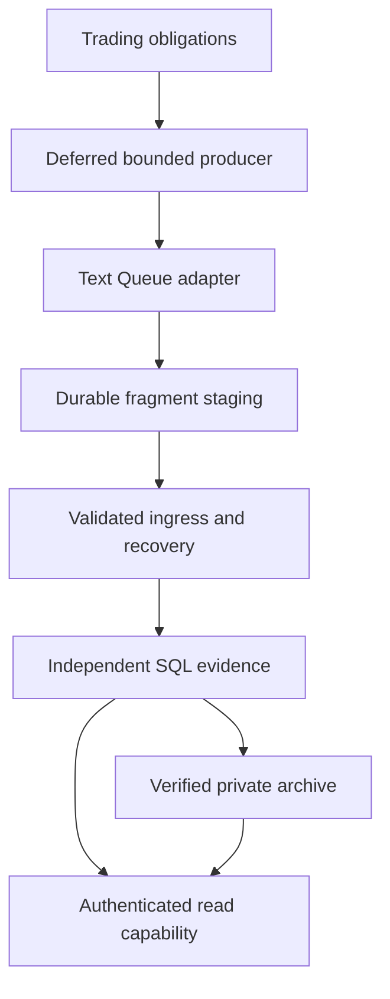

# Independent B1 measurement — Package A

This package is a disabled code foundation for isolated qualification. It creates no cloud resources and is not a Production-readiness verdict. Package B must qualify actual Queue/DLQ, D1, R2, Worker resource limits, 48-hour outage recovery, seven-day catch-up and cost. Package C requires separate activation authorization.

## Baseline and compatibility

Parent: `f7b351da1a3be7530b36e1edc051ca6029d44794`, tree `406fde3e5c5debe1620a57fccfa21c383cdb7612`. Its parent is accepted M3 `36ca52a6ea47a6cffe3067d9756d4a908563b19d`. Accepted M2/M1 remain ancestors. The published M3 branch is not the Package-A worktree.

Accepted envelope, producer, Engine, codec, consumer-validation and M3 transport implementations remain unchanged. Native M2 keeps its synchronous final-return contract. The two authorized native operational follow-ups are separate Candidate/Official deferral counters and opt-in SQL diagnostic recording. No duplicate fast path was added to native M2.

Trading integration selects `B1_MEASUREMENT_PLANE=independent` independently of capture. Capture rollback retains this selection. Independent failures never invoke legacy Trading-D1 measurement collection, storage, retention or reporting. Existing historical legacy evidence is not deleted or migrated. Legacy reporting remains a separate capability; it is never presented as independent coverage.

## Boundary and ownership

These are adapter boundaries, not deployed resources. Trading receives only a future Queue producer binding. It receives no Measurement-D1, R2 or maintenance capability. The dedicated Measurement Worker rejects Trading-D1, feed and trading credential bindings. Its ordinary handlers are authenticated bounded GET reporting/health, Queue consumption and scheduled recovery. They expose no migration, repair, restore, correction, archive deletion or arbitrary database-injection endpoint.

`measurement-maintenance.js` creates an internal, independently gated maintenance capability. It requires environment/expiry/operation authorization and checks the durable database marker. It is not installed on ordinary request handlers. Resource qualification installation is ADMIN-only SQL, absent from runtime handlers. This internal separation is not claimed as platform-enforced deployment isolation.

## Asynchronous D1 response contract

`measurement-d1-response-v1` uses `VALIDATED_AT_REVISION`. A SQL read validates the complete bounded dependency snapshot together. The response remains a historical observation if another isolate commits while hashing or response delivery awaits. It never claims unqualified return-time `CURRENT`.

The descriptor includes:

| Field | Meaning |
| --- | --- |
| `responseVersion`, `scope`, `definitionVersion` | Explicit interpretation/cohort/subject domain |
| `revisionEpoch` | Random durable database incarnation; prevents numeric-revision ABA after replacement/restore |
| `validatedRevision`, `liveRevision` | Subject validation revision and report visibility boundary |
| `projectionRevision`, `projectionDigest`, `payload` | Exact projection source revision and cryptographic payload binding |
| `stateAtRevision` | `COMPLETE`, `PARTIAL`, `CONFLICT` or validated `PENDING` |
| `dependencyIdentity` | Pending ingress, recovery, lifecycle, corrections, conflicts/quarantine, complete binding identities and member state/absence, availability, source projection, market revision and archive root |
| `evidenceIdentity` | Hot immutable evidence membership plus archive and projection fact identities; not merely a count |
| `availabilityBoundary` | First durable scope evidence, available-through boundary, projection availability and SQL validation time |

A missing/stale/unavailable projection returns `NOT_VALIDATED` or revision-qualified `PENDING`. Durable `ACCEPTED`/`DUPLICATE` ingestion is independent from analytical projection or processing completion. The D1 classifier is explicit; the new response is not fed blindly into the offline M3 classifier.

Every protected mutation repeats current durable SQL checks atomically with its write. These cover epoch/revisions, complete bindings, pending ingress, quarantine/conflict, corrections, recovery, availability, market membership and lease generation/nonce where applicable. A prior response is never continuing write authority. R2 publication, eviction and restore use their own fenced state machines. No Durable Object or global coordinator was added.

## Durable transport and ingress

M3's exact 42,000-byte chunks, deterministic identities and 60,000-byte fragment envelopes are preserved. Queue bodies are text. Provider message IDs are operational metadata, never evidence identity.

A per-message acknowledgement follows durable bounded fragment/event state and recovery-job registration. It does not imply assembled-envelope validation, canonical evidence commit, projection validation, processing completion or archive verification. Another Worker can finish from SQL state without final-fragment redelivery. Partial transport is not yet validated semantic ingress; validation/affected-subject barriers precede canonical lookup, conflict handling and reduction.

Assembled bytes enter the accepted public wire validator. The new D1 path registers affected evaluations/signals and semantic dependents durably before canonical reconciliation. Failures leave pending/recovery ownership, not a process-local lock. Canonical conflicts do not overwrite accepted decisions. Cross-kind bindings reconcile the same canonical decision digest. Archived canonical identities participate in the same checks.

SQL stages large records as invisible metadata plus bounded base64 chunks, then publishes visibility under the ingress fence. Canonical D1 writers use deterministic identity encoding so compressor differences cannot change retry chunks. Readers retain explicit identity/gzip codec support with bounded decompression and digest verification. Restores may rebuild local physical encoding without changing logical wire bytes or semantic identity.

Explicit retry classifications distinguish dependency pending, retryable, durability unknown, integrity conflict, malformed/permanent and expiry. Complete analytical uncertainty is reconciled by event identity. Dependency waiting does not exhaust a poison retry counter merely because the parent has not arrived.

Partial expiry cannot be reset by redelivery/replay. The first known provider-publication timestamp is used when available; otherwise the persisted first durable receipt is the declared clock basis. Later deliveries cannot extend the deadline. Complete unresolved retries expire to an explicit terminal DLQ state. Accepted complete events retain normal evidence idempotency after transport expiry. Replay requires explicit maintenance authorization, a fresh deadline/state fence and separately admitted work; it cannot bypass expiry/conflict or reuse a stale response.

Terminal capture retains original frames, manifest, identities, failure class, attempts, clocks and reason. Replay generations have separate immutable forensic records. Replayable DLQ state remains hot until its deadline; terminal cleanup requires verified archive closure for the current generation and a fresh expiry/generation SQL fence. Poison capture has a separate 131,072-byte ceiling and uses ordinary bounded record chunks. Inputs beyond that ceiling remain unacknowledged with truthful unknown durability. Provider-decoded JSON is labelled as an observed representation when original wire bytes are unavailable. DLQ is not permanent archival storage.

## Census and post-entry evidence

Genuine `ENGINE_REJECTED / direction:none` and `SKIPPED` evaluations retain their accepted census semantics and never enter directional outcome processing. No BUY/SELL, levels or post-entry observations are fabricated.

An independently received valid census whose cycle is missing gets a durable `CENSUS_CAPTURE` record while canonical ingestion remains `DEPENDENCY_PENDING`. Reporting merges capture/canonical records by evaluation and decision digest, including across pages. Later canonical acceptance does not double the denominator.

Census publication has a separate archive domain. It preserves decisions, classification, clocks, canonical binding proof, definitions and captured conflict/missingness without requiring optional raw cycle detail. Missing optional detail cannot erase the census view. The old mislabeled early-rejection fixture remains rejected by unchanged accepted validation.

`measurement-market-v1` exports only already observed ticks/closed bars after trading. Stable sample identity covers source/session/sequence or bar time. Occurrence, receipt/source availability and export observation remain distinct. Overlapping exports deduplicate by sample identity and payload digest. Packets carry explicit truncation/gaps and unknown broker completeness. A selected session or absence of supported observed inputs is explicit. OHLC provides intervals, never invented barrier order.

Outcome recovery consumes bounded hot/archive pages, persists a fenced accumulator and replays earlier backfill rather than silently skipping it. It reuses the accepted pure reducer. New results are immutable versions; durable analytical availability is no earlier than the containing SQL visibility boundary, independently of source/reducer observation clocks. Rejected/skipped census remains census-only.

## Archive publication and discovery

The private-R2-style adapter has no deletion method. Objects are immutable/content-addressed, with complete byte readback, length/hash/UTF-8/codec checks. Upload acknowledgement alone is not verification.

Publication follows `PLANNED → SNAPSHOT_PINNED → OBJECTS_WRITTEN → VERIFIED → CATALOGUED → EVICTION_ELIGIBLE`. A snapshot fixes explicit bounded membership, input/archive revisions, dependency scope state, counts, definitions, policy and availability. Every transition is durable/fenced and resumable.

Archive membership revisions are separate from lifecycle input revisions. Derived results invalidate archive membership without unnecessarily invalidating a lifecycle projection. Bounded publication selects explicit membership; it never claims the whole historical scope fits a single segment. Required dependency closure is verified.

Catalogue construction checkpoints bounded members/sample aliases in SQL. Only authoritative catalogue/root publication has a durable serialized slot; unrelated ingestion/processing remains independent. Stale owners cannot advance another generation. A separate durable root-checkpoint job survives a crash after SQL root registration. Later source changes may invalidate eviction, while the earlier authorized root remains a truthful historical generation.

The cumulative immutable radix catalogue provides semantic record, canonical semantic-event, sample, scope, lifecycle-fact and cohort-market lookup. Cold detail lives in R2; hot D1 retains bounded roots/active indexes. No permanent D1 row is required for each historical object. Root discovery scans bounded pages with continuation, rejects uncommitted/corrupt candidates, and uses an explicit verified-predecessor fallback policy. Archive-only discovery does not require the original D1 catalogue.

Interpretation sources are retained as data, never executed. Supported Engine/codec/reducer source digests are validated. A synthetic archive-v1→v2 migration writes and separately verifies replacements, records supersession and preserves old objects/readability. Unsupported interpretation/format versions fail explicitly.

## Restore, retention and eviction

Read-through reporting never writes/hydrates D1. Authorized restore reserves capacity, starts at a verified root, verifies identities/definitions/dependencies, rebuilds local references, preserves original occurrence/observation/durable availability, records restoration time separately and resumes by bounded offset. A new target has a new epoch. Restore cannot overwrite a newer live lifecycle or lease generation. Policy-expired inactive evidence restores as historical data without reactivating processing.

Policy uses original creation time: Candidate live raw target 30 days; derived detail/correction admission through +90 days; admitted correction completion allowance through +120 days; Official forensic minimum +455 days, extended for active/unresolved/held closure. Census/required definitions have long-term archive retention. Corrections do not restart admission clocks. Archive copies conservatively retain shared dependencies; destructive cloud deletion remains disabled.

Eviction requires complete readback verification, a recoverable root, parity proof, exact current source/dependency revisions, no pending ingress/correction/processing/pins and current catalogue authority. It preserves semantic discovery/location identity. A correction, new ingress, quarantine transition or unavailable object blocks stale eviction. Logical DELETE grants zero automatic physical credit. Pinned reports either preserve the same semantic result or explicitly report unavailable after their live snapshot is evicted.

Append-only correction admissions retain predecessor digest/revision, original clock, first durable admission, dependencies, reason and state. Competing corrections against one predecessor explicitly conflict. Immutable result/state versions preserve history. Missing/unreducible/late corrections fail truthfully and do not hold live work indefinitely. Original raw evidence needed for admitted work remains retained through its allowance.

## Reporting and coverage

Authenticated reporting pins cohort, definition, event range, asOf, catalogue generation, live revision and epoch in a signed bounded continuation. It reads immutable versions, not a newer mutable projection labelled as old history. Queries return explicit storage, availability, integrity, retention and coverage dimensions. Archive outage is unavailable/pending, never an empty historical partition.

Views separate census and immutable result/correction evidence from all-detail export. Merge/dedup uses semantic identity/digest/version, not row counts. Results and denominator are page-scoped until the query completes. Object/decoded-byte/record/time/traversal budgets are explicit; continuation progresses through filtered capture records/catalogue aliases. Budget retry guidance can request a smaller page or a larger allowed budget without changing snapshot identity.

`COMPLETE_FOR_SCOPE` requires verified captured cycle/census proof for an explicitly requested captured scope. It never proves uncaptured intervals or scheduled opportunities had zero evaluations. Otherwise coverage remains `KNOWN_GAPS` or `UNKNOWN_CAPTURE`. Incidents distinguish observation/inference, known/unknown counts, clocks, state and supporting evidence. Failure of both transport and incident storage is reported as unknown durability. An external heartbeat witness is required; this package creates no external monitoring resource.

## Reservations and bounded work

Decimal model: normal target 4,000,000,000 bytes, recovery reserve 1,500,000,000, hard ceiling 5,500,000,000. Reserve partitions cover incidents, catch-up, archive and restore. Ordinary work cannot consume recovery capacity. SQL admission occurs before protected writes and is atomic across isolates.

Stable reservations have bounded estimates, owner/generation/random token/epoch, future-liability state and idempotent release/settlement. `SETTLED` means no more work is owed by that admission, not physically reclaimed space. Renewed work rotates token ownership. No DELETE automatically reduces allocation accounting.

The conservative default model holds estimated physical use. A separately ADMIN-installed Package-B qualification proof is required before `size_after` observations may reconcile completed unused estimates. Reconciliation pins epoch/resource/deletion revision, preserves every unfinished committed/reserved liability, rejects stale observations, and requires explicit reuse qualification after logical deletion. Settled physical allocation is conservatively charged to the normal base; physical class attribution is not invented. No qualification proof is installed by default or by ordinary handlers. Actual D1 allocation/reuse/amplification remains a Package-B gate.

Hard limits bound rows, 60,000-byte payloads, 42,000-byte chunks, parameters, statement/batch bytes, live events/scopes/jobs/metadata, traversal and decompression. Worker composition admits at most 900 prepared D1 statements per invocation and bounded archive adapter operations. SQL nonce leases survive isolates/restarts; stale completion cannot release newer work. The durable scheduler rotates class opportunities with bounded age/deadline-aware selection, so a busy class cannot permanently monopolize all passes.

## Qualification, configuration and rollback

Templates under `deployment/b1-independent/` contain placeholders, no resource IDs/secrets, and every activation gate OFF. Producer capture, real handoff, consumer, market export, archive write/reporting/eviction, correction, restore and independent reporting are independently controlled. Archive write does not imply eviction; reporting does not imply hydration.

The dependency-injected qualification harness requires an explicit environment marker, separate exact resource name/ID/bucket-namespace allowlists, expiry/stage authorization and observed identity match before work. It prepares scenario, archive-only restore, rollback and actual 48-hour pause/continuing-arrival/seven-day catch-up protocols. Local emulation never claims cloud qualification. No Package-B execution occurs here. The plan-only CLI does not provision, deploy, call cloud APIs or change credentials.

Rollback controls are distinct: capture OFF while keeping the independent cohort; processing/eviction pause while retaining backlog; version rollback only to schema/archive-compatible artifacts. The residual-remediation rollback floor is schema 0011 with supported archive interpretation. Migration 0008 persists the restore target boundary; additive 0009 records immutable archive-lineage authorization while preserving the target D1 epoch. Additive 0010 stores bounded publication proof progress and a durable reference-change boundary; migrations 0001–0009 remain unchanged by this successor. Additive 0011 assigns bounded live-reference sequence identities so unrelated publication does not reset immutable-history proof; migrations 0001–0010 are unchanged. See B1-PACKAGE-A-LIVENESS.md for confirmation and continuing-publication progress. See B1-PACKAGE-A-LONG-HISTORY.md for the preceding resumable verification contract. See B1-PACKAGE-A-RESIDUAL-REMEDIATION.md for authenticated transitions and fenced terminal-publication retirement. Never purge Queue/DLQ, delete archive, reset semantic/availability clocks, restore an old database without later history reconciliation, or re-enable Trading-D1 measurement as rollback.

## Validation and quantitative status

Focused development tests exercise delayed/out-of-order responses, stale write fences, independent native connections, admission races/ABA, fragment/ack/restart recovery, archive crash/readback/root/catalogue cases, correction/retention, census independence, restore and bounded reporting. They supplement all unchanged native M2 final-return, M1/M3, parity and policy gates.

`scripts/measure-b1-package-a.mjs` produces local payload/duplication/fragment/staging/reservation/SQL/physical-page/index/archive/correction/restore/report/CPU/memory/producer observations and labelled backlog/catch-up models. A separate 4,032-subject SQL recovery test measures two independent connections. These are local measurements, not Worker CPU/memory, physical D1 budget, throughput, monthly cost, retention-plan or Production guarantees.

The final validation report and recovery bundle are produced only after the complete consolidated acceptance pass succeeds. No publication, manual CI, deployment or Package B/C follows automatically.

Platform contract references checked during development: [D1 batch transactions](https://developers.cloudflare.com/d1/worker-api/d1-database/), [D1 limits](https://developers.cloudflare.com/d1/platform/limits/), [Queue acknowledgement/retry](https://developers.cloudflare.com/queues/configuration/batching-retries/), [Queue limits](https://developers.cloudflare.com/queues/platform/limits/), and [Worker subrequest limits](https://developers.cloudflare.com/workers/platform/limits/). Actual selected-plan behavior must be qualified in Package B.

## Final review remediation contract

PA-FINAL-01 through PA-FINAL-08 are addressed by the scoped successor described in `B1-PACKAGE-A-REMEDIATION.md`. Historical duplicate durability never authorizes stale workflow reconciliation. Expired rootless catalogue slots are durably invalidated only when their exact source/closure changed. Restore rebuilds sample identities, charges their index overhead, and installs verified cold authority only in its fenced completion transaction.

Coverage is resolved at the pinned availability/revision/catalogue boundary and authenticated in continuation tokens; known gaps take precedence. Every page returns `denominatorScope=PAGE_ONLY` and `queryTotals=null`; clients may aggregate the returned semantic records, but the API does not claim a query total. Correction admission and completion deadlines use the SQL execution clock. Runtime recovery releases expired uncommitted reservations through token/owner fences.

The future qualification driver must return workload counts for all named categories during both outage and catch-up, recovery observations for retries/multipart/corrections/readback/reporting, and decimal-byte resource occupancy/reservation dimensions. Absent categories, non-continuing arrivals, and contradictory resource accounting fail validation. Local emulation remains distinct from cloud qualification.
